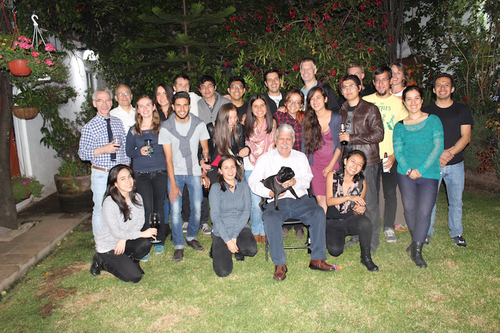

A pivotal moment in my career came on June of 2016 when I had the opportunity to meet <a class='link' href="http://faculty.sites.uci.edu/mdlee/">Michael D. Lee</a> during his second visit to UNAM.

During his visit, Michael gave two lecture presentations introducing Bayesian cognitive modeling. The first was directed to the general population of undergraduate students in the School of Psychology, and the second was directed to the students in Lab25:

- An introduction to the benefits of Bayesian Modeling (<a class='link' href="https://bouzaslab25.github.io/presentations/Lee_BayesianBenefits.pdf" target="_blank">View slides</a>)
- A comprehensive overview of Bayesian Modeling in Cognitive Science (<a class='link' href="https://bouzaslab25.github.io/presentations/Lee_June2016.pdf" target="_blank">View slides</a>)

Meeting Michael was a transformative experience for me. It marked my first formal exposure to Bayesian modeling, a framework that would later become central to my research work. Little did I know that years later I would be working with Michael as a Ph.D. co-advisor at UC Irvine!

<figure class="event-figure event-figure--feature">
    
</figure>
