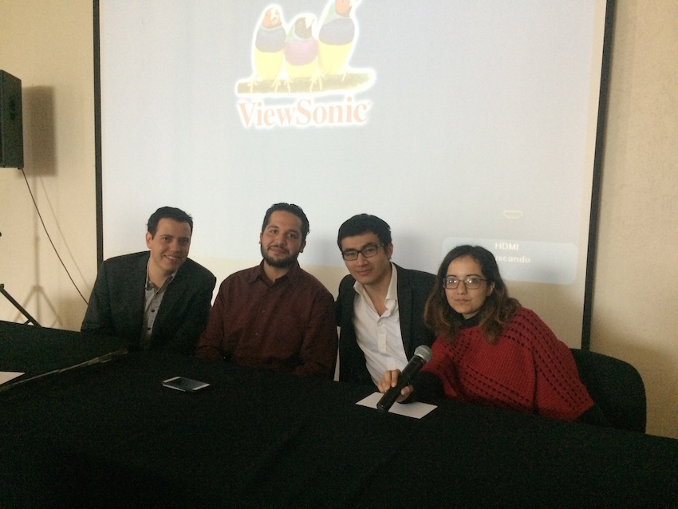

In November 2017, the lab traveled to the beautiful city of Tlaxcala to participate in the VI International Seminar about Behavior and Applications (SINCA), hosted by the University of Tlaxcala. 

I presented a conference talk as part of a symposium, along with my labmates and friendsCarlos Velázquez Vargas, Jesús Manuel Ulloa Villareal, and José Manuel Niño García. 

The symposioum *"Modelos de adaptabilidad en entornos dinámicos: Estudios sobre detección, preferencias y probabilidad"* touched on the general topic of adaptability to dynamic environments, with each of us presenting a study on a different area of decision-making:

- Prediction in gradually changing environments (Carlos Velázquez Vargas)
- Experimental design through simulation (Jesús Manuel Ulloa Villareal)
- Transitivity in gains and losses (José Manuel Niño García)
- The Mirror Effect in perception (Adriana Felisa Chávez De la Peña)

<figure class="event-figure event-figure--feature">
    
</figure>
