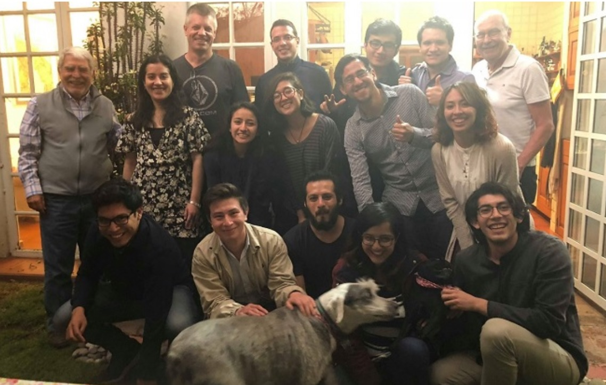

In March 2018, we had the pleasure of hosting Dr. Michael Lee for his third visit to Lab25. Having first met him in 2016, it was remarkable to see how my understanding of Bayesian cognitive modeling had evolved with each of his visits.

### A Mentor's Impact

Michael's influence on my academic journey has been profound. From our first meeting when I was an undergraduate student exploring Bayesian methods, to this visit where I was preparing for graduate school applications, his guidance has been invaluable. During this visit, I had the opportunity to discuss my research on the Mirror Effect and get his insights on applying hierarchical Bayesian models to my data.

### Collaborative Spirit

What makes Michael's visits special is his genuine enthusiasm for helping students develop their projects. His ability to suggest the most appropriate modeling approaches while encouraging us to push our analytical boundaries has been instrumental in shaping my approach to Bayesian modeling and statistical reasoning.

<figure class="event-figure event-figure--feature">
    
</figure>
