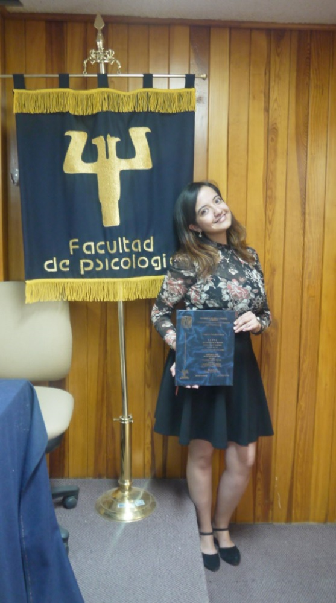
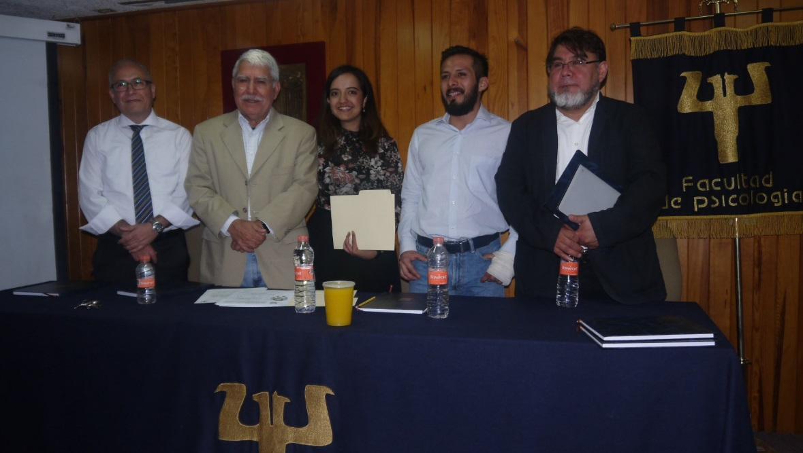

On March 13th, 2018, I successfully defended my bachelor's thesis "Studies on Signal Detection" at the School of Psychology, UNAM. This marked the completion of my B.A. in Psychology with a GPA of 9.79/10.0, graduating with merits.

<figure class="event-figure event-figure--feature">
    
</figure>

### Research Committee

I was fortunate to have my work evaluated by an exceptional committee:

- Dr. Arturo Bouzas (Advisor)
- Dr. Germán Palafox (Reviewer)
- Dr. Óscar Zamora (Reviewer)
- B.A. José Luis Baroja (Reviewer)

<figure class="event-figure">
    
</figure>

### Thesis Overview

My research explored the generalizability of the Mirror Effect—a phenomenon well-documented in recognition memory—to the domain of visual perception. Using Signal Detection Theory and the Ebbinghaus illusion, we demonstrated how patterns typically observed in memory tasks could also emerge in pure perception tasks.
