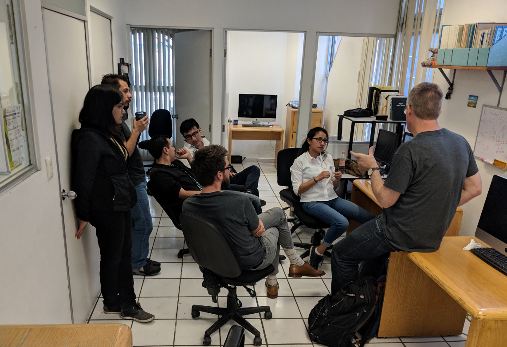
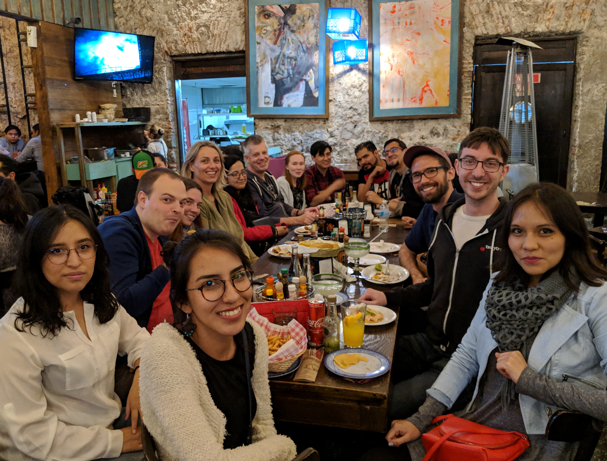

In March 2019, we had the pleasure of hosting an exceptional team from UC Irvine at Lab25. Dr. Michael Lee returned to UNAM, this time accompanied by distinguished colleagues and students from UCI's cognitive sciences department:

- Dr. Joachim Vandekerckhove (who would later become <a href="https://cidlab.com/people/" target="_blank">my Ph.D. advisor</a>)
- <a href="https://alexanderetz.com/about/" target="_blank">Alexander Etz</a> 
- Holly Westfall 
- Mac Strelioff

### Research Exchange

During their visit, members of Lab25 and the UCI team engaged in a series of informal talks and presentations, sharing our research projects and interests. This visit was particularly meaningful for me as I was preparing for graduate school applications at the time. The discussions and feedback I received during these sessions would later prove invaluable in shaping my research trajectory. Little did I know then that this visit would foreshadow my future academic home, as I would later join UCI's Cognitive Sciences department to work with Joachim, Jeff, and Michael.

    <figure class="event-figure">
        
        <figcaption>Lab25 and the UCI team</figcaption>
    </figure>
    <figure class="event-figure">
        
        <figcaption>Dinner at Coyoacán</figcaption>
    </figure>

