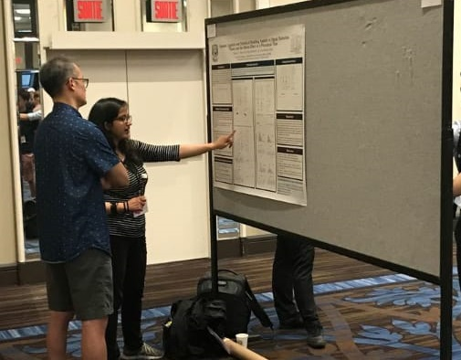

From July 19th to 23rd, 2019, I had the exciting opportunity to attend the 52nd Annual Meeting of the Society for Mathematical Psychology (MathPsych) in Montreal, Canada. This marked my first participation in what would become my academic home conference.

### Research Presentation

I presented a poster titled "The Mirror Effect in Visual Perception: Evidence from Signal Detection Theory," which was the culmination of my undergraduate thesis work. This presentation was particularly meaningful as it represented my first opportunity to share my research with the mathematical psychology community—the same community I hoped to join as a graduate student.

<figure class="event-figure event-figure--feature">
    
</figure>

You can view the full poster here: <a href="/posters/Poster_Adriana_MathPsych2019.pdf" target="_blank">View Poster</a>.
