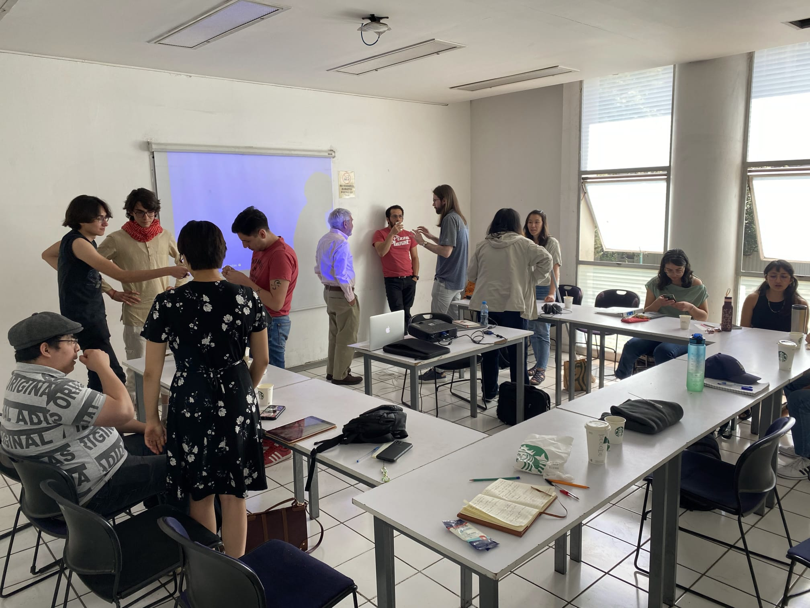

Between March 25th and 29th, 2024, I was part of a workshop on Bayesian statistics at the UNAM in Mexico City. The workshop was organized by the Michael D. Lee at the University of California, Irvine, who extended the invitation to Dr. Alexander Etz from the University of Texas Austin, and to a small group of advanced graduate students. The workshop was directed mostly to undergraduate students in [Lab 25](http://www.bouzaslab25.com/){:target="_blank"}, led by Dr. Arturo Bouzas.

During this workshop, we presented our work on Bayesian cognitive modeling and listened to the presentations of the Lab 25 students in the morning, and spent the afternoon providing feedback and discussing Lab25 projects.

<figure class="event-figure event-figure--feature">
    
    <figcaption>A picture taken in between sessions at the UNAM Workshop on Bayesian Modeling</figcaption>
</figure>
