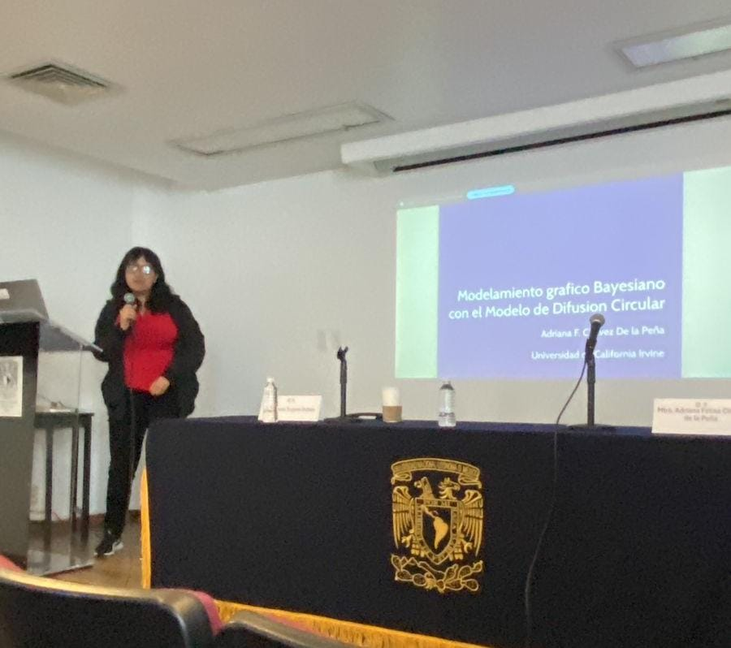
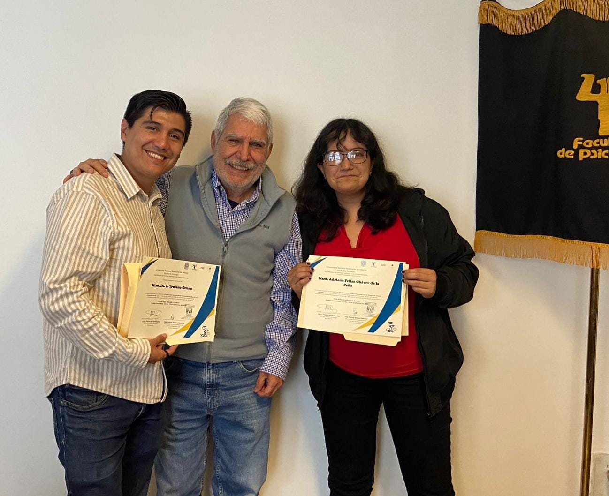

I had the honor of returning to my alma mater, UNAM, to deliver an invited keynote presentation alongside my former Lab25 colleague, Darío Trujano. It was a special moment to share our research journeys that began in this very institution.

<figure class="event-figure event-figure--feature">
    
    <figcaption>Delivering the keynote presentation on Bayesian modeling and cognitive science at UNAM</figcaption>
</figure>

### Research Presentations

The session featured two talks showcasing different applications of Bayesian modeling in psychology:

- "Modelamiento grafico Bayesiano con el modelo de difusion circular" (Bayesian Graphical Modeling with the Circular Diffusion Model) by me!
- "¿Cuánto pagar por descubrir? Comparando a Bayes y el comportamiento" *(How much to pay for discovery? Comparing Bayes and behavior)* by Darío Trujano

### Watch the Talk (in Spanish)

You can watch my presentation here (starting at 1:13:31):

    <iframe src="https://www.youtube.com/embed/xuCWxZdy8oc?start=4411" title="Keynote presentation at UNAM" allow="accelerometer; autoplay; clipboard-write; encrypted-media; gyroscope; picture-in-picture" allowfullscreen></iframe>

Presenting at UNAM as an invited speaker was particularly meaningful, as it represented a full circle moment in my academic journey. From my undergraduate days at Lab25 to returning as a senior Ph.D. candidate from UC Irvine, this talk symbolized both personal growth and the enduring connection between these two institutions that have shaped my academic career.

<figure class="event-figure">
    
    <figcaption>With my former undergraduate advisor (Dr Arturo Bouzas) and former lab mate Dario Trujano after the keynote presentation</figcaption>
</figure>
