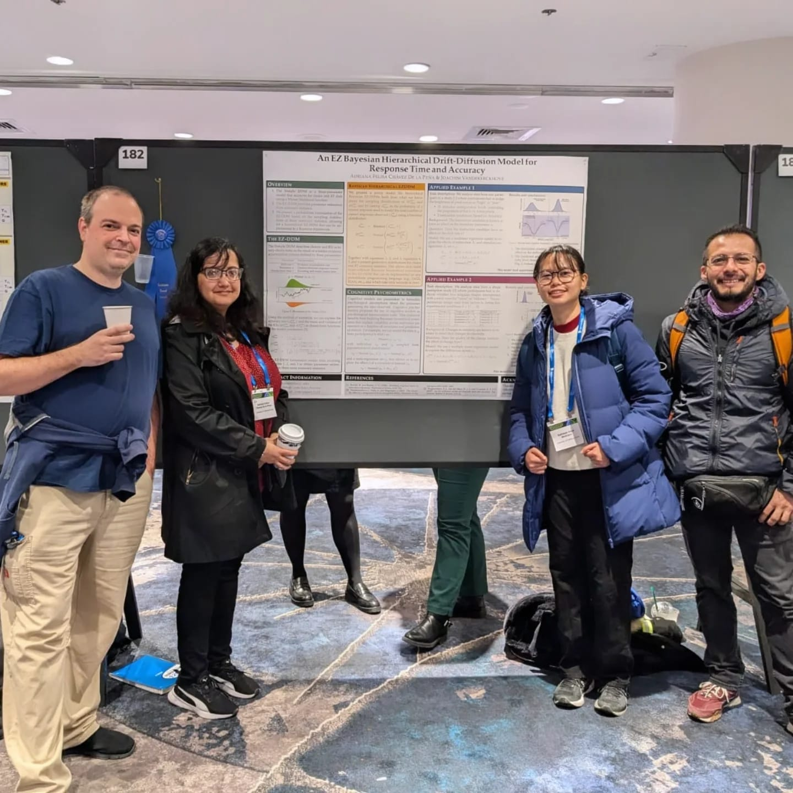

I had the honor of presenting my research at the annual Psychonomic Society meeting in New York City. My work on the Bayesian implementation of the EZ-drift diffusion model was recognized with a Graduate Travel Award, supporting my participation in this amazing conference which offered a great opportunity to obtain feedback from leading researchers in the field.

    <figure class="event-figure">
        
        <figcaption>Receiving the Graduate Travel Award at the 2024 Psychonomic Society Meeting in New York City</figcaption>
    </figure>
    <figure class="event-figure">
        
        <figcaption>Presenting my research on the EZBHDDM at Psychonomics 2024</figcaption>
    </figure>

### Research Presentation

My poster presentation, titled "EZ Bayesian Hierarchical Drift Diffusion Model: A Computationally Efficient Approach to Decision Process Modeling," introduced a novel Bayesian implementation of the EZ-drift diffusion model (EZDDM). This approach makes parameter estimation for the drift diffusion model computationally inexpensive while offering the flexibility of Bayesian modeling.

The model uses binomial and normal distributions to model the sampling distributions of key summary statistics, enabling versatile extensions such as hierarchical models, cognitive latent variable models, and metaregression structures. Our "EZ Bayesian hierarchical drift diffusion model" (EZBHDDM) serves as a hyper-efficient proxy model to the hierarchical DDM that can be implemented in any probabilistic programming language.

Through simulation studies and applied examples using the graphical Bayesian analysis package JASP, we demonstrated the efficacy and efficiency of our model in real-world applications.
